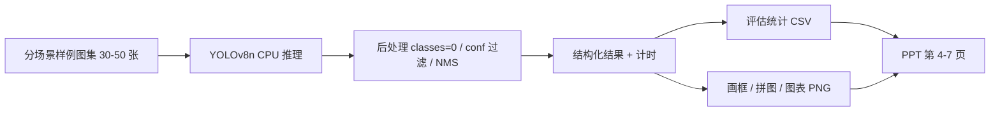

# 基于 YOLO 的行人检测课程设计 · 开工文档

| 项目 | 内容 |
| --- | --- |
| 版本 | v0.1（待团队评审） |
| 日期 | 2026-11-12 |
| 状态 | 待确认，见第 10 节待决事项 |
| 同步对象 | 课程设计小组全员 |
| 交付形态 | **仅 PPT + 5–7 分钟汇报，不交源码** |
| 文档用途 | 统一技术路线、划分阶段与模块、明确分工与红线 |

---

## 0. 一页速览

**一句话定位**：本工程的唯一目标是稳定产出 PPT 第 4–7 页所需的图与表；代码是生产资料，不是交付物。

**汇报题目定位**：基于预训练 YOLO 模型的行人检测性能评估与场景适应性分析。

**技术栈**：Python 3.13 + venv / PyTorch CPU / ultralytics YOLOv8n / OpenCV / NumPy / Matplotlib。

**工程规模**：3 个脚本（`detector.py` / `evaluate.py` / `visualize.py`）+ 1 份配置，约 200–300 行。

**工作量**：约 4 人日；3 人并行约 2 天。

**需要团队在同步会上拍板的 5 件事**：

1. 是否认可"不训练模型、只做评估分析"的定位。
2. 30–50 张测试图的来源与使用授权。
3. 汇报机器是否允许联网首次下载 `yolov8n.pt`（否则预置权重）。
4. 老师是否明确要求"训练过模型"（若是，启用备选阶段 S2.5）。
5. 人数与分工、PPT 汇报人及彩排时间。

---

## 1. 项目定位与交付约束

### 1.1 交付物清单

| 交付物 | 说明 | 是否提交 |
| --- | --- | --- |
| 8 页 PPT | 唯一提交物 | 是 |
| 6 分 30 秒讲稿 | 口头交付 | 是 |
| 静态检测效果图 | 嵌入 PPT，含兜底页 | 是（作为图片） |
| 工程源码、环境、数据集 | 仅用于生产素材 | **否** |

### 1.2 由约束推出的设计原则

- **最小依赖、最小代码量**：每多一个包就多一处环境风险，而老师看不到源码。
- **每个文件必须对应 PPT 某一页**：没有落点的代码不写，避免"做了很多没地方放"。
- **产物优先于代码优雅**：图、表、数字的质量 > 代码结构。
- **所有数字必须有口径与出处**：官方数据标注来源与测试条件，自测数据标注样本量与硬件。
- **不做现场演示**：6 分钟内跑程序、放长视频都属于高风险动作。

### 1.3 汇报定位话术（写进第 1 页）

> 本课程设计定位为「基于预训练 YOLO 模型的行人检测性能评估与场景适应性分析」，重点在模型选型依据、置信度阈值权衡与复杂场景下的失效原因分析。

提前写死这句话，用于应对"你没有训练，这也算课程设计吗"。它完全落在"基于 YOLO 的行人检测"题目内，且分析含量高于在 CPU 上草草微调几十个 epoch。

---

## 2. 总体架构

### 2.1 技术栈分层

| 层 | 选型 | 说明 | 可否替换 |
| --- | --- | --- | --- |
| 应用产出层 | OpenCV + NumPy + Matplotlib（+ pandas 可选） | 画框、拼图、统计图、汇总 CSV | 可，只要能出图 |
| 检测框架层 | ultralytics（YOLOv8n / `yolov8n.pt`） | 加载官方 COCO 预训练权重、推理、内置 NMS | 不建议 |
| 计算底座 | PyTorch CPU | 张量运算，ultralytics 的依赖 | **不可**（由上层锁定） |

依赖方向为「产出层 ← 检测框架层 ← 计算底座」。选定 ultralytics 即自动锁定 PyTorch，底座没有讨论空间；真正可自由裁剪的只有最上面的产出层。

### 2.2 数据流



这条流水线同时就是 PPT 第 4 页「实验设计」的配图——它也是 YOLO 真实的工作过程，能把原理页和实验页连起来讲。

### 2.3 依赖清单与本机状态

| 包 | 用途 | 本机状态 | 必需 |
| --- | --- | --- | --- |
| Python 3.13.14 + venv | 运行环境 | 已具备（venv 待建） | 是 |
| `torch` 2.x（CPU） | 计算底座 | 已装 | 是 |
| `opencv-python` | 读图、画框、拼图 | 已装 | 是 |
| `numpy` | 数值统计 | 已装 | 是 |
| `ultralytics` 8.4.x | 检测推理 | **待装** | 是 |
| `matplotlib` | 所有图表 | **待装** | 是 |
| `pandas` | 汇总 CSV | **待装** | 可选 |
| `pyyaml` | 读 `exp.yaml` | 随 ultralytics 附带，无需单装 | 自动 |
| `yolov8n.pt` / `yolov8s.pt` | 官方预训练权重 | **首次运行自动下载** | 是 |

环境结论（已核实 PyPI）：本机 3.13 上 torch、numpy、matplotlib、pandas 均有 `cp313` wheel；ultralytics 为纯 Python wheel；opencv-python 为 `abi3` wheel。均可正常安装。建 venv 的理由是**隔离课程依赖、固化版本**，不是 Python 版本不兼容。

### 2.4 明确不做（Non-goals）

- 不写 `train.py`、不做模型训练或微调（除非启用 S2.5）。
- 不做 GUI / Web 界面 / 实时摄像头演示 / 多线程架构。
- 不做标注数据集、不做标注格式转换、不做自测 mAP。
- 不做 ONNX 导出、量化、部署、Docker、CI。
- 不做多目标跟踪、人数统计算法、跨线计数。
- 不引用他人项目的结果数字。

### 2.5 许可与合规

- ultralytics 为 **AGPL-3.0**，教学使用无问题，不做闭源分发。
- 参考项目多数无 License 或为占位符，**仅借思路，不复制代码、图片、数字**。
- 测试图片需确认来源与授权（见 Q2）；建议使用公开数据集样例或自行拍摄。

---

## 3. 工程目录与产物约定

```
YoloPedestrian-Det/
├── docs/
│   └── KICKOFF.md               # 本文档
├── configs/
│   └── exp.yaml                 # 全部实验参数的单一来源
├── weights/                     # 预置权重（离线时需要）
├── data/
│   ├── samples/                 # 测试图，按场景分子目录
│   │   ├── day/  night/  occlusion/  crowd/  small/
│   └── labels.csv               # 人工计数真值
├── src/
│   ├── detector.py              # 推理、过滤、计时、结构化
│   ├── evaluate.py              # 三组实验统计，输出 CSV
│   └── visualize.py             # 所有 PNG 图表
├── results/
│   ├── figures/                 # 直接拖进 PPT 的图
│   ├── tables/                  # 直接粘进 PPT 的表
│   └── detection_samples/       # 画框后的单图
└── requirements.txt             # 不提交，仅保证自己重跑数值一致
```

**命名规范**（团队同步重点，务必统一）：

| 对象 | 规则 | 示例 |
| --- | --- | --- |
| 测试图 | `{scene}_{id:03d}.jpg`，全英文路径、无空格 | `night_007.jpg` |
| 真值表 | 列：`image_id,scene,person_count,note` | `night_007,night,4,远处两人较模糊` |
| 图表 | `{实验}_{指标}.png` | `threshold_pr_curve.png` |
| 数据表 | `{实验}.csv` | `scene_breakdown.csv` |
| 画框图 | `det_{原图名}.jpg` | `det_night_007.jpg` |

---

## 4. 模块设计

每个模块统一按「职责 / 输入 / 输出 / 接口 / 依赖 / 验收标准」定义。

### 4.1 `configs/exp.yaml` — 参数模块

- **职责**：所有实验参数的单一来源，禁止在脚本中散落魔法数字。
- **输入**：人工编辑。
- **输出**：被 3 个脚本共同读取的配置对象。
- **结构**：

```yaml
model:
  primary: yolov8n.pt
  compare: yolov8s.pt
  weights_dir: weights
inference:
  imgsz: 640
  classes: [0]
  iou: 0.45
  conf_default: 0.25
  device: cpu
  warmup: 3
  repeat: 5
experiments:
  threshold:
    start: 0.05
    stop: 0.90
    step: 0.05
    model: primary
  scenes: [day, night, occlusion, crowd, small]
paths:
  samples: data/samples
  labels: data/labels.csv
  figures: results/figures
  tables: results/tables
  detection_samples: results/detection_samples
```

- **依赖**：`pyyaml`（随 ultralytics）。
- **验收**：修改 `conf_default` 后三组实验同步生效，无需改动任何 Python 文件；PPT 第 4 页参数表可直接照抄此文件。

### 4.2 `src/detector.py` — 推理模块

- **职责**：**唯一**与 ultralytics 打交道的模块；加载权重、推理、过滤 person 类、计时、结果结构化。
- **输入**：图片路径 + `exp.yaml` 中的推理参数。
- **输出**：`DetectResult` 列表。

```python
@dataclass
class Detection:
    xyxy: tuple[float, float, float, float]
    conf: float

@dataclass
class DetectResult:
    image_id: str
    scene: str
    width: int
    height: int
    detections: list[Detection]
    latency_ms: float
```

- **接口**：
  - `load_model(weight: str, device: str = "cpu") -> YOLO`
  - `detect_image(model, path: str, **params) -> DetectResult`
  - `detect_batch(model, paths: list[str], **params) -> list[DetectResult]`
- **计时口径**（必须写进 PPT 脚注）：预热 `warmup` 次后，对同一图重复 `repeat` 次取**中位数**；只计模型前向推理，不含读图与画框。
- **依赖**：ultralytics、cv2、numpy。
- **验收**：单图返回 person 框与稳定的 `latency_ms`；`classes=[0]` 生效；同一图重复运行耗时波动 < 10%。
- **已知坑**：
  - COCO 原始 JSON 里 person 的 `category_id` 是 **1**，但 ultralytics 的类别索引是 **0**。本项目只用 `classes=[0]` 过滤，不做标注转换，两者不要混淆。
  - 首次运行自动下载权重，需联网；离线环境把 `.pt` 放进 `weights/`。
  - 路径含中文或空格可能导致读取失败，统一使用全英文路径。

### 4.3 `src/evaluate.py` — 评估模块

- **职责**：三组实验的统计逻辑，只产 CSV，**不画图**。
- **输入**：`DetectResult` 列表 + `labels.csv`。
- **输出**：3 份 CSV。

| 实验 | 函数 | 做法 | 输出 |
| --- | --- | --- | --- |
| E1 阈值敏感性 | `threshold_sweep()` | `conf` 从 0.05 到 0.90 步进 0.05，逐档统计总检出数、误检数、召回率；标出"召回优先"拐点 | `threshold_sweep.csv` |
| E2 模型尺寸对比 | `model_benchmark()` | `yolov8n` vs `yolov8s` 在同一批图上，统计单图中位延迟、FPS、检出数 | `model_benchmark.csv` |
| E3 场景鲁棒性 | `scene_breakdown()` | 按 5 个场景分组，统计漏检数 / 漏检率 / 误检数 | `scene_breakdown.csv` |

- **指标口径**（PPT 必须注明，避免被追问）：
  - 检出数 = 置信度过滤 + NMS 后剩余框数。
  - 误检数 ≈ `max(0, 检出数 − person_count)`，需人眼抽样复核。
  - 漏检数 ≈ `max(0, person_count − 检出数)`。
  - 这是**计数级近似评估**，不是基于 IoU 的 mAP；mAP 一律引用官方数据。
- **依赖**：numpy、csv（pandas 可选）。
- **验收**：三份 CSV 列名固定、可直接粘贴进 PPT；同一输入重跑结果完全一致。

### 4.4 `src/visualize.py` — 出图模块

- **职责**：产出所有 PNG，统一风格，禁止在 PPT 里手工美化。
- **输入**：`DetectResult` 列表 + 三份 CSV。
- **输出**：PPT 直接可用的图。

| 函数 | 产物 | 对应页 |
| --- | --- | --- |
| `draw_boxes()` | 单图画框结果 | 第 2、5、7 页 |
| `make_grid()` | 2×2 四宫格（正常 / 遮挡 / 夜间 / 密集） | 第 5 页 |
| `plot_threshold_curve()` | 双线图：召回率 vs 误检数 | 第 6 页 |
| `plot_latency_compare()` | n vs s 延迟对比柱状图 | 第 5 页 |
| `plot_scene_bars()` | 五场景漏检率分组柱状图 | 第 7 页 |

- **风格约定**：统一中文字体（如 Microsoft YaHei，避免乱码）、`dpi=200`、统一配色、每张图标单位与样本量 `n`。
- **依赖**：matplotlib、cv2、pandas（可选）。
- **验收**：所有图可直接拖入 PPT，无需裁剪；中文不乱码；同类图配色一致。

### 4.5 `results/` — 产物登记表

每份产物登记「文件名 / 对应 PPT 页 / 数据来源 / 复核人」，装订前逐项打勾：

| 产物 | PPT 页 | 数据来源 | 复核 |
| --- | --- | --- | --- |
| `threshold_sweep.csv` + 曲线 | 6 | 自测 | ☐ |
| `model_benchmark.csv` + 延迟图 | 5 | 自测 | ☐ |
| `scene_breakdown.csv` + 柱状图 | 7 | 自测 | ☐ |
| 四宫格效果图 | 5 | 自测 | ☐ |
| 失败案例图 | 7 | 自测 | ☐ |
| 官方模型性能表 | 3、5 | Ultralytics 官方文档 | ☐ |

---

## 5. 功能阶段实现划分

| 阶段 | 目标 | 交付物 | 验收标准 | 依赖 | 估算 |
| --- | --- | --- | --- | --- | --- |
| **S0 环境与基线** | 建 venv、装包、拿到权重、跑通单图推理 | venv、`requirements.txt`、`weights/`、一张画框图 | 单图能检出 person 并输出耗时；确认纯 CPU 可用 | — | 0.5 人日 |
| **S1 数据与真值** | 收集 30–50 张图并按 5 场景分组，人工数人数 | `data/samples/`、`labels.csv`、`exp.yaml` | 每场景 ≥ 6 张；真值表无缺失；路径全英文 | S0 | 0.5 人日 |
| **S2 推理模块** | 封装 detector.py | `src/detector.py` | 批量推理返回结构化结果 + 稳定耗时 | S0、S1 | 0.5 人日 |
| **S3 评估模块** | 跑完三组实验 | 3 份 CSV | 数字可复现、口径写清、能直接粘 PPT | S2 | 1 人日 |
| **S4 可视化模块** | 产出全部图表 | 所有 PNG | 风格统一、中文不乱码、无需二次裁剪 | S3 | 1 人日 |
| **S5 核验与装订** | 数字复核、按 8 页填图、讲稿与彩排 | 8 页 PPT + 讲稿 + 静态兜底页 | 试讲 ≤ 7 分钟；每个数字可说出来源 | S4 | 0.5 人日 |

**合计约 4 人日**；3 人按第 6 节并行约 2 天（S0/S1 → S2/S3 → S4 → S5 串行为主）。

**S2.5 备选阶段（默认关闭）**：仅当老师明确要求"训练过模型"时启用。用小数据子集微调 10–20 epoch，产出 1 页 loss / mAP 曲线，替换第 4 页部分内容；增加约 1 人日，且需额外说明 CPU 训练条件。启用与否由 Q4 拍板。

---

## 6. 团队分工建议（3 人示例，按实际人数调整）

| 角色 | 负责阶段 | 主要交付物 |
| --- | --- | --- |
| **A · 数据与基线** | S0、S1 | venv、权重、图集、`labels.csv`、`exp.yaml` |
| **B · 推理与评估** | S2、S3 | `detector.py`、`evaluate.py`、3 份 CSV、指标口径说明 |
| **C · 出图与汇报** | S4、S5 | `visualize.py`、全部 PNG、8 页 PPT、讲稿、彩排 |
| **全员** | S5 复核 | 逐项核对产物登记表、数据来源、试讲计时 |

- 若只有 1 人：严格按 S0 → S5 顺序执行，约 4 天。
- 并行关键：A 完成 `labels.csv` 与 `exp.yaml` 之前，B 不要开始写死字段；C 可在 S3 期间先定图表模板与配色。
- 交接物只有三样：`exp.yaml`、3 份 CSV、`DetectResult` 结构定义，避免口头传递口径。

---

## 7. 工程产物 ↔ PPT 页映射

| PPT 页 | 内容 | 来自哪个模块 / 数据 |
| --- | --- | --- |
| 1 封面 | 题目、定位话术、成员 | 本文档 §1.3 |
| 2 问题与难点 | 遮挡 / 小目标 / 夜间 / 密集 四张小图 | `visualize.py` + `data/samples/` |
| 3 原理与方案选型 | YOLOv8 结构示意 + 官方性能表 | 官方文档附录 A |
| 4 实验设计 | 流水线图 + 参数表 + 三组实验 | `exp.yaml` + 本文档 §2.2 |
| 5 结果一 · 指标与选型 | 官方表 + 自测延迟 + 四宫格效果图 | `model_benchmark.csv`、`make_grid()` |
| 6 结果二 · 阈值与场景 | 阈值曲线 + 明确结论 | `threshold_sweep.csv`、`plot_threshold_curve()` |
| 7 问题与改进 | 漏检柱状图 + 四类错误归因表 | `scene_breakdown.csv`、`plot_scene_bars()` |
| 8 总结 | 三条结论 | 全组 |

**原则：每个文件都有 PPT 落点，每页 PPT 都有数据支撑。** 出现"做了没处放"或"要图没跑出来"都视为阶段验收未通过。

---

## 8. 实验设计与指标口径

### 8.1 三组实验

1. **E1 阈值敏感性**：`conf` 0.05→0.90 步进 0.05（18 档），仅对主模型 `yolov8n` 扫描，统计每档召回与误检，画双线曲线找拐点。行人检测漏检代价高于误检，结论取"召回优先"侧。
2. **E2 模型尺寸对比**：`yolov8n` vs `yolov8s` 在同一批图上实测中位延迟与 FPS，与官方 CPU ONNX 基准（80.4 ms / 128.4 ms）对照，论证无 GPU 环境选 n 的合理性。
3. **E3 场景鲁棒性**：白天 / 夜间 / 遮挡 / 密集人群 / 小目标五组，统计漏检率，输出分组柱状图，作为第 7 页失败分析的主体。

### 8.2 官方数据引用规范

- 引用 Ultralytics 官方文档 YOLOv8 检测模型表时，**必须标注**：COCO val、输入 640、CPU ONNX 延迟为官方特定硬件基准、换机器数值会变。
- 自测数据必须标注：样本量 `n`、本机 CPU 型号、计时口径（预热 + 中位数、仅前向）。
- **绝不把官方数据说成自测结果**，也不引用他人课程项目的指标。

---

## 9. 风险与红线

| 风险 | 影响 | 对策 |
| --- | --- | --- |
| 现场演示失败（设备 / 编码 / 超时） | 直接损失 1–2 分钟 | 只用静态拼图；想放 10 秒 GIF 必配静态兜底页 |
| 被问"没训练算课程设计吗" | 定位被质疑 | 定位话术写进第 1 页，全员统一口径 |
| 数字口径被追问 | 可信度下降 | 官方数据标条件、自测数据标样本量与硬件 |
| 近似指标被当成 mAP | 学术不严谨 | PPT 明确写"计数级近似评估"，mAP 只引官方 |
| 中文图表乱码 | 观感差 | 统一指定中文字体，S4 验收项 |
| 首次下载权重失败 | S0 卡住 | 预置 `weights/`，Q3 拍板 |
| CPU 推理慢 | 进度拖延 | 控制 30–50 张、E1 只扫主模型、批量复用模型实例 |
| 路径含中文 / 空格 | 读图失败 | 全英文路径，S1 验收项 |
| 参考项目数字不可信 | 答辩穿帮 | 一律不引用他人结果（典型反例：某项目写 mAP50-95 = 91.6%，远超官方 YOLOv8x 的 53.9） |
| 范围蔓延（有人想加界面/训练） | 挤占出图时间 | 以 §2.4 Non-goals 为准，新增需求走 Q4 |

---

## 10. 待决事项（同步会上逐条拍板）

| 编号 | 事项 | 选项 | 建议 | 负责人 | 截止 |
| --- | --- | --- | --- | --- | --- |
| Q1 | 是否认可"不训练、只做评估分析"定位 | 认可 / 改为必须训练 | 认可 | 全员 | 同步会 |
| Q2 | 测试图来源与授权 | 公开数据集样例 / 自拍 / 混合 | 混合，标注来源 | A | S1 前 |
| Q3 | 汇报机是否允许联网下载权重 | 允许 / 预置 `weights/` | 预置，双保险 | A | S0 |
| Q4 | 老师是否明确要求训练 | 是 / 否 | 否；若是启用 S2.5 | 全员 | 同步会 |
| Q5 | 人数与分工 | 1 人 / 3 人 | 按 §6 三人并行 | 全员 | 同步会 |
| Q6 | PPT 模板、汇报人、彩排时间 | — | 出图后定，至少 1 次计时试讲 | C | S5 |
| Q7 | E1 阈值扫描范围 | 全扫 18 档 / 只测 0.25、0.5、0.75 三档 | 全扫（成本仅几分钟） | B | S3 |

---

## 11. 参考资料与数据来源

**权威来源**

- Ultralytics YOLOv8 官方文档 — 模型性能表（附录 A）、val / predict 模式说明。
- Ultralytics 官方文档 — YOLOv8 许可证 AGPL-3.0。

**仅借思路、不引用数据的参考项目**

| 项目 | 借鉴点 |
| --- | --- |
| `charrrrls/yolo_evaluation` | 阈值搜索脚本思路、n/s/m 模型对比、输出图清单（PR 曲线、置信度分布、单图延迟对比）、报告组织方式 |
| `saint1st/pedestrian-detection` | 四类错误分类框架（定位偏差 / 标注噪声 / 幻觉误检 / 小目标遮挡漏检）、conf 与 IoU 参数扫描、good/mid/bad 分组样例图编排 |
| `lehoangchibach/people_detection` | 课程汇报 PDF 的页结构、独立的性能评估 notebook 组织方式 |
| `harshm2601/People-Detection-Crowd-Counting` | README 九段目录作为汇报大纲参考（其指标数字不可信，禁止引用） |

以上项目多数无明确 License，**只允许参考方法论与文档结构**。

---

## 附录 A · 官方 YOLOv8 检测模型性能表

数据来源：Ultralytics 官方文档，COCO val，输入尺寸 640。CPU 速度为官方特定硬件的 ONNX 基准。

| 模型 | mAPval 50-95 | CPU ONNX (ms) | A100 TensorRT (ms) | 参数量 (M) | FLOPs (B) |
| --- | --- | --- | --- | --- | --- |
| YOLOv8n | 37.3 | 80.4 | 0.99 | 3.2 | 8.7 |
| YOLOv8s | 44.9 | 128.4 | 1.20 | 11.2 | 28.6 |
| YOLOv8m | 50.2 | 234.7 | 1.83 | 25.9 | 78.9 |
| YOLOv8l | 52.9 | 375.2 | 2.39 | 43.7 | 165.1 |
| YOLOv8x | 53.9 | 479.1 | 3.53 | 68.2 | 257.8 |

选型结论：n→x 精度仅提升 16.6 点，CPU 延迟涨至约 6 倍、参数量约 21 倍；本机无 GPU，选 `yolov8n` 为合理折中。

## 附录 B · PPT 8 页与时间分配

| 页 | 内容 | 时长 |
| --- | --- | --- |
| 1 | 封面与定位 | 10 s |
| 2 | 问题与难点 | 40 s |
| 3 | 原理与方案选型 | 70 s |
| 4 | 实验设计 | 40 s |
| 5 | 结果一 · 指标与选型 | 70 s |
| 6 | 结果二 · 阈值与场景 | 90 s |
| 7 | 问题与改进 | 50 s |
| 8 | 总结 | 20 s |
| **合计** | | **390 s（6 分 30 秒，留 30 秒缓冲）** |

结果与分析（第 5、6 页）合计 160 秒，占 41%，是汇报重心。不得把时间平摊给原理页。

## 附录 C · 变更记录

| 版本 | 日期 | 变更 |
| --- | --- | --- |
| v0.1 | 2026-11-12 | 初稿：整合交付约束、技术栈、架构、模块、阶段、分工、风险与待决事项，供团队同步评审 |
