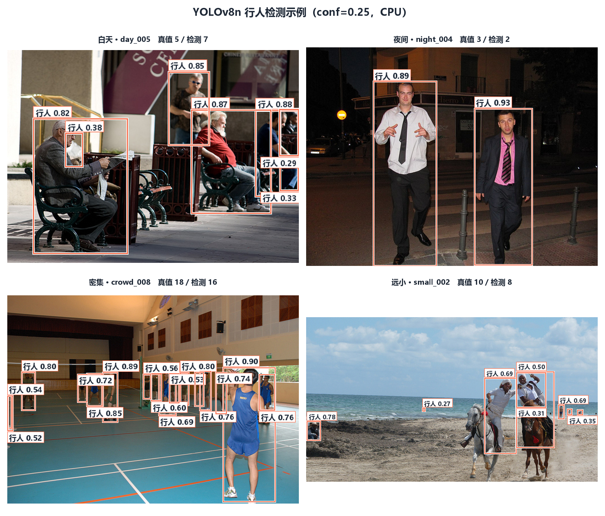
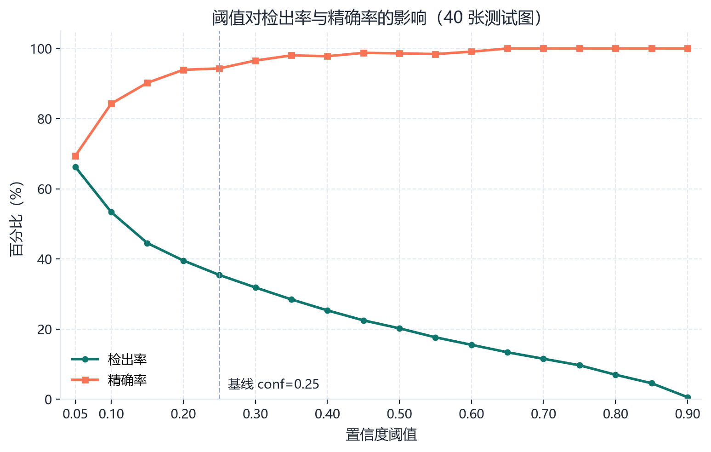

# YoloPedestrian-Det

基于 YOLOv8n 的行人检测性能评估（课程设计）。在 40 张 COCO val2017 图像、5 类场景上做纯 CPU 推理，统计检出 / 误检 / 漏检，并给出阈值权衡、CPU 耗时与失败案例。

**只做推理和评测，不训练、不做界面。**

## 结果摘要

| 指标 | 数值 |
|---|---|
| 测试图 / 真值 | 40 张 / 703 人 |
| 检测框 | 264 |
| 检出 / 误检 / 漏检 | 249 / 15 / 454 |
| 检出率 | 35.4% |
| 精确率 | 94.3% |
| 单张 CPU 耗时 | 117.5 ms |

> 35.4% 是总体计数口径，受两张密集图影响很大：`night_007` + `crowd_005` 占真值 46%、漏检 67%；40 张逐图检出率中位数是 88.9%。

| 场景 | 图数 | 真值 | 检测 | 检出率 | 漏检率 |
|---|---:|---:|---:|---:|---:|
| day | 8 | 37 | 37 | 89.2% | 10.8% |
| night | 8 | 199 | 44 | 21.1% | 78.9% |
| occlusion | 8 | 38 | 46 | 100.0% | 0.0% |
| crowd | 8 | 376 | 113 | 30.1% | 69.9% |
| small | 8 | 53 | 24 | 43.4% | 56.6% |

## 快速开始

要求：Python 3.13（本项目在 3.13.14 上测试），CPU 即可，无需 GPU。

```powershell
python -m venv venv
venv\Scripts\activate
pip install -r requirements.txt

python src/detector.py    # 冒烟：单图 / 批量 / 计时
python src/evaluate.py    # 生成三份 CSV
python src/visualize.py   # 生成图表、样图与失败案例
```

Linux / macOS 把激活命令换成 `source venv/bin/activate` 即可。

`weights/yolov8n.pt` 已随仓库提供，不需要另外下载。三个脚本有先后依赖：`visualize.py` 读取 `evaluate.py` 生成的 CSV，因此先跑 `evaluate.py`。

### 输出位置

- `results/tables/threshold_sweep.csv`：0.05–0.90 共 18 档阈值指标
- `results/tables/scene_breakdown.csv`：五场景检出 / 误检 / 漏检
- `results/tables/model_benchmark.csv`：本机 yolov8n 耗时 + 官方 yolov8s 参照
- `results/figures/`：四宫格、阈值双线图、耗时对比图、场景漏检柱状图
- `results/detection_samples/`：5 张场景样图 + 8 张失败案例

## 项目结构

```text
YoloPedestrian-Det/
├── README.md
├── requirements.txt
├── configs/
│   └── exp.yaml              # 全部实验参数（模型、阈值、场景、计时口径）
├── data/
│   ├── samples/              # 40 张测试图，按 day/night/occlusion/crowd/small 分组
│   ├── labels.csv            # 每张图的人工人数真值
│   └── SOURCES.md            # 图片来源与逐图 URL 登记
├── docs/
│   ├── KICKOFF.md            # 任务拆解与进度
│   ├── metrics_note.md       # 指标口径、复核记录与引用注意
│   ├── figure_check.md       # 图件乱码 / 裁剪检查记录
│   └── references.md         # 官方数据、COCO、YOLOv8 引用清单
├── results/
│   ├── figures/
│   ├── tables/
│   └── detection_samples/
├── src/
│   ├── detector.py           # 推理层：加载、单图 / 批量、计时
│   ├── evaluate.py           # 指标层：计数口径、阈值扫描、写 CSV
│   └── visualize.py          # 展示层：画框、四宫格、统计图
└── weights/
    └── yolov8n.pt
```

## 实验设置

- **数据**：COCO val2017，40 张，5 场景各 8 张；图片与逐图来源见 [data/SOURCES.md](data/SOURCES.md)。
- **模型**：YOLOv8n COCO 预训练权重，`imgsz=640`，`classes=[0]`（只保留 person）。
- **基线阈值**：`conf=0.25`，NMS `iou=0.70`，全程 CPU。
- **计时**：预热 3 张，正式 20 张取均值；只统计 `preprocess + inference + postprocess`，`torch` 单线程，测完恢复原线程数。
- **参数来源**：全部读取 [configs/exp.yaml](configs/exp.yaml)，代码中不写死。

## 指标口径

真值只有每张图的人工总人数，没有逐人框，因此采用图像级计数口径：

- 检出 `TP = min(检测数, 真值)`
- 误检 `FP = max(检测数 - 真值, 0)`
- 漏检 `FN = max(真值 - 检测数, 0)`
- 检出率 `ΣTP / Σ真值`，精确率 `ΣTP / Σ检测数`

这意味着：

1. 同一人被重复检测会计入误检；
2. 框位置错误不影响检出 / 漏检，只要数量对得上就算检出；
3. 因此该指标**不能等同于 mAP**，适合课程场景下的快速横向比较。

更完整的口径、复核记录和报告引用注意事项见 [docs/metrics_note.md](docs/metrics_note.md)。

## 主要图表





其他图：

- [五场景漏检率](results/figures/scene_miss_rate.png)
- [CPU 耗时对比](results/figures/latency_compare.png)
- [失败案例目录](results/detection_samples)

## 数据与引用

- 数据集：COCO val2017（Lin et al., *Microsoft COCO: Common Objects in Context*, ECCV 2014）。
- 模型：Ultralytics YOLOv8，AGPL-3.0 / Enterprise 双许可。
- 图片：来自 Flickr，单张图片版权与许可见原页面；COCO 标注许可为 CC BY 4.0。
- 官方 yolov8s 128.4 ms 为 COCO val / 640 / CPU ONNX 口径，与本机 PyTorch 117.5 ms **不可直接比较**；官方同口径 yolov8n 为 80.4 ms。

完整引用格式、BibTeX 与核对结论见 [docs/references.md](docs/references.md)。

## 已知局限

- 40 张图是小样本，结果不代表 COCO 全量性能。
- `night_007`（约 160 人，±20）与 `crowd_005`（约 165 人，±10）为人工估算真值，对应场景漏检率有计数误差。
- CPU 耗时受机器负载影响，本项目曾观察到 110.8–146.9 ms 的波动。
- 计数口径不校验框位置，不能替代 mAP / AP 评估。

## 文档索引

| 文档 | 内容 |
|---|---|
| [docs/KICKOFF.md](docs/KICKOFF.md) | 任务拆解、进度与交付说明 |
| [docs/metrics_note.md](docs/metrics_note.md) | 指标定义、复核记录、引用注意 |
| [docs/figure_check.md](docs/figure_check.md) | 图件乱码与裁剪检查 |
| [docs/references.md](docs/references.md) | 官方数据、COCO、YOLOv8 引用清单 |
| [data/SOURCES.md](data/SOURCES.md) | 40 张图片的逐图来源与 URL |
| [data/labels.csv](data/labels.csv) | 每张图的人工人数真值 |

## 说明

本项目仅用于课程设计与学习。代码未单独声明开源许可；第三方依赖、模型和数据的许可请遵循各自原始条款。
